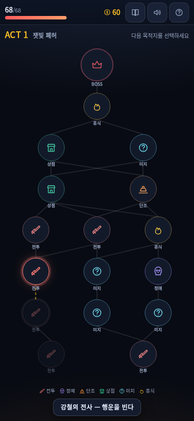
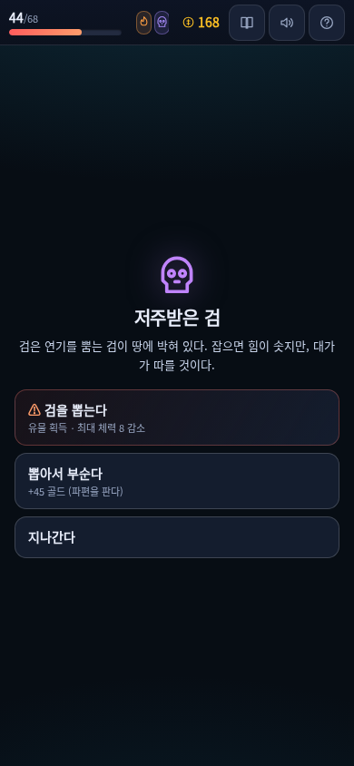
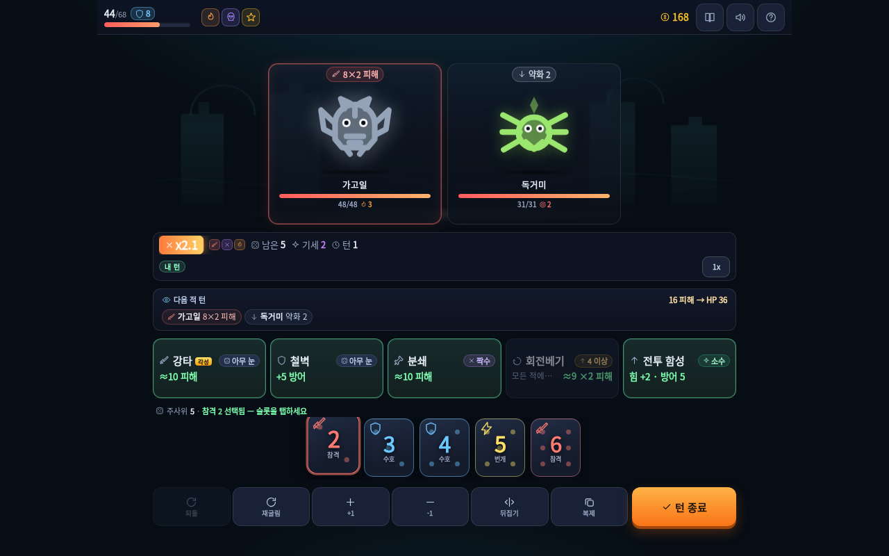

# 🎲 다이스 체인 · Dice Chain RPG

> 주사위를 굴리고, 눈을 바꾸고, 연쇄를 터뜨려라.

주사위 6면을 직접 **단조(forge)**하며 빌드를 만드는 로그라이크 덱빌더.
*Slice & Dice*의 완전 정보 전투, *Dicey Dungeons*의 슬롯 조건, *Balatro*의 연쇄 배율을 한 손에 담았습니다.

**▶ 플레이: https://secretbasesys.github.io/dice-chain-rpg/**

- 모바일(390×844) · 데스크톱(1280×800) 대응, 설치 없이 브라우저에서 실행
- 서버·외부 라이브러리·이미지 파일 없음 (CSS/JS/SVG/WebAudio 자체 생성)
- 진행 상황은 `localStorage`에 저장 — 도감·승천 해금은 런이 끝나도 유지

---

## 스크린샷

| 전투 (모바일 390×844) | 도감 · 업적 | 맵 |
|---|---|---|
|  |  |  |

| 이벤트 선택 | 상점 | 데스크톱 (1280×800) |
|---|---|---|
|  |  |  |

## 게임 방법

1. **굴린다** — 매 턴 가방 속 주사위가 전부 굴려집니다.
2. **배치한다** — 주사위를 **끌어다 놓거나** 탭 → 슬롯을 탭. 슬롯만 탭하면 조건에 맞는 최고 눈이 자동 배치됩니다.
3. **조건을 맞춘다** — 슬롯마다 `아무 눈 / 짝수 / 홀수 / 4 이상 / 소수 / 6` 조건이 있습니다.
4. **조작한다** — 기세(⚡)를 써서 `재굴림 · +1 · -1 · 뒤집기(7-x) · 복제`.
5. **연쇄한다** — 한 턴에 스킬을 이어 쓸수록 배율이 오릅니다 (최대 ×3.5). 3·5·7연쇄에서 화면이 터집니다.
6. **단조한다** — 단조 노드에서 주사위의 **개별 면**을 영구 교체. 이것이 곧 빌드입니다.

### 조작감 · 정보

- **되돌리기(Undo)** — 같은 턴 안에서 배치·재굴림·눈 조작을 되돌립니다 (`Z` 키 또는 ↺ 버튼).
- **완전 정보** — 주사위를 고르면 슬롯마다 예상 피해·방어·처치 여부가 표시되고,
  상단 예고 패널에 **다음 적 턴 총 피해와 치명 경고**가 뜹니다.
- **1x / 2x 배속** 토글, 상태이상·조건·유물·의도는 **탭하면 즉시 툴팁**.
- PC에서는 `1~9` 주사위 선택, `Enter` 턴 종료, `Z` 되돌리기.

## 클래스

| 클래스 | HP | 기세 | 특징 |
|---|---|---|---|
| 강철의 전사 | 68 | 2 | 방어도를 남기면 다음 턴 3 피해. 맞으면서 때린다 |
| 불꽃의 마도사 | 76 | 3 | 턴마다 기세 +1, 화염·번개 면을 쓰면 2 회복 |
| 운명의 도박사 | 76 | 4 | 콤보 3 이상이면 공격마다 +3 피해 |

## 시스템

- **단조** — 주사위 면 하나를 5개 후보 중에서 교체. 가격은 막(Act)마다 상승.
- **스킬 각성** — 상점의 「각성의 서」 또는 보상으로 스킬 하나를 영구 강화 (5개 슬롯 전부 각성 가능).
- **미지 이벤트 14종** — 제단·도박·저주·거래·함정. 선택지가 이어지는 2단 이벤트와 확률 분기 포함.
- **보스 고유 기믹** — 슬라임 여왕은 체력 50%에서 분열, 리치는 한 번 되살아나고, 주사위 군주는 3턴마다 주사위를 봉인합니다.
- **유물 18종** — 화염 특화, 반격, 콤보, 골드, 저주 계약 등.
- **도감 · 업적** — 주사위 15 · 유물 18 · 적 20종 수집, 업적 8종.
- **승천(Ascension) 0~5** — 승리할 때마다 단계가 해금됩니다. 적 체력·공격, 시작 골드, 상점 가격이 누적해서 어려워집니다.

## 밸런스 (봇 시뮬레이션)

`DC.test.sim()` 그리디 봇 기준, 승천 0에서 클래스별 승률은 대략 **전사 70~75% · 마도사 60~65% · 도박사 60~65%**.
승천 4~5는 같은 봇으로 10~50%까지 떨어집니다 (사람은 상점·각성·이벤트 선택으로 더 높게 나옵니다).

## 개발

```
src/
  data.js    정적 데이터 — 주사위·면·클래스·스킬·유물·적·보스·이벤트·승천·업적
  art.js     적 20종 + 막별 배경 손그림 SVG
  meta.js    도감·승천·업적 영구 저장
  dice.js    주사위 모델 (굴림·면 교체)
  map.js     막별 분기 맵 생성
  combat.js  전투 엔진 (스냅샷 되돌리기·보스 기믹·연쇄 배율)
  audio.js   WebAudio 합성 효과음
  fx.js      파티클·화면 흔들림·배너
  ui.js      전 화면 렌더 + 드래그·툴팁·애니메이션
  main.js    런 진행·이벤트 효과·상점·저장, 봇 시뮬 레이어
tests/       Playwright 검증 스크립트 (모바일/데스크톱 스크린샷, 레이아웃, 시뮬레이션)
```

단일 파일 빌드: `python3 build.py` → `downloads/dice-chain-rpg.html` (오프라인 실행 가능)

## 검증

- Playwright로 `390×844` · `1280×800` 전 화면 스크린샷 촬영 및 육안 확인
- 콘솔 에러 0, 가로 오버플로 0, 40px 미만 터치 타깃 0 (배속 칩 제외)
- `DC.test.autoRun()` 봇으로 클래스·승천별 승률 시뮬레이션
