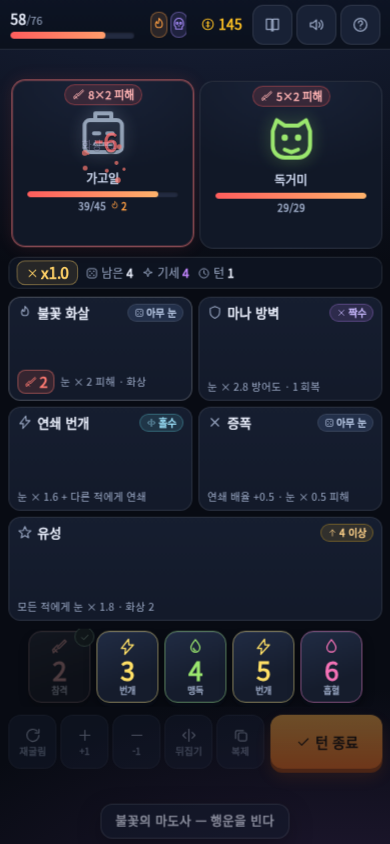
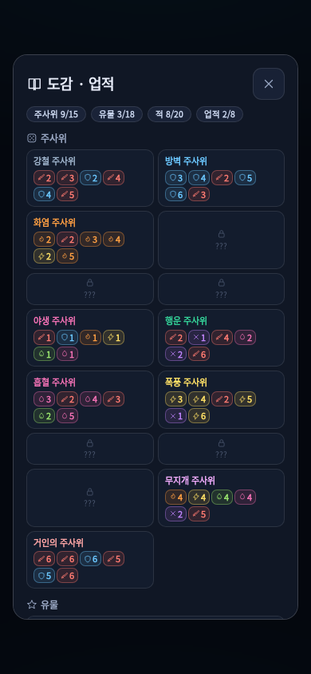
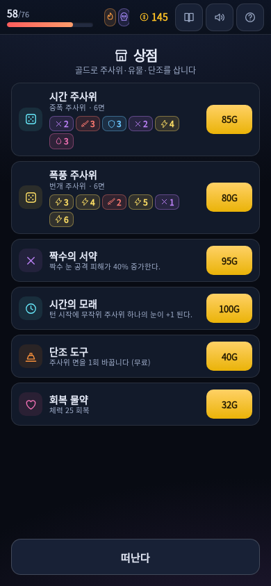
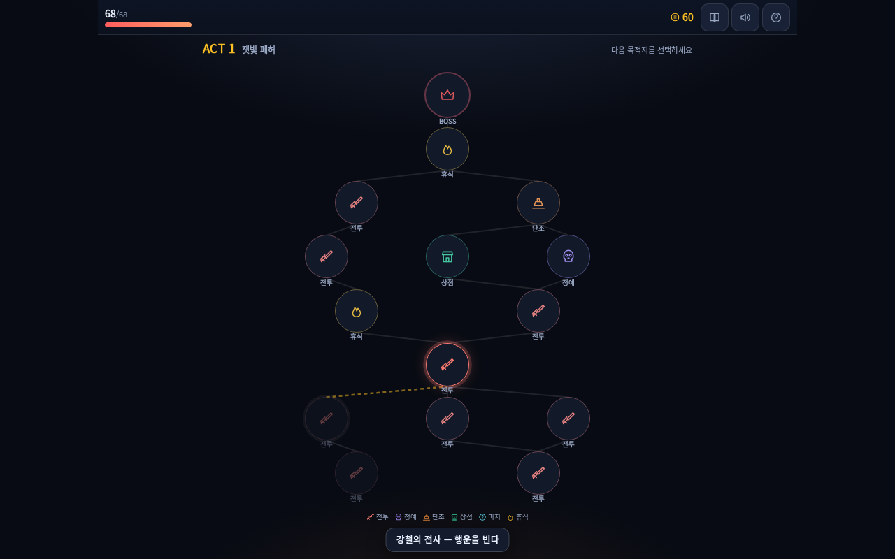
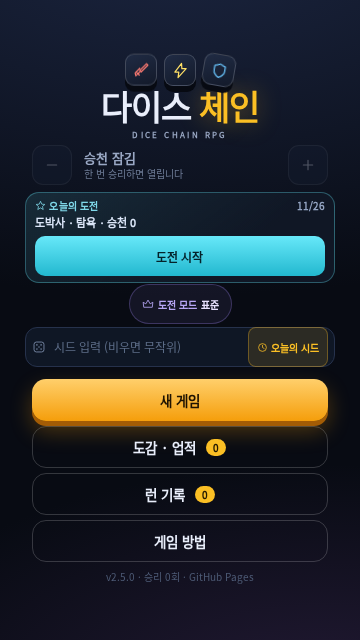
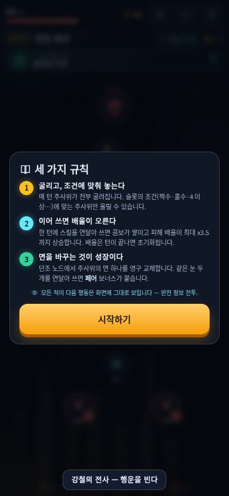
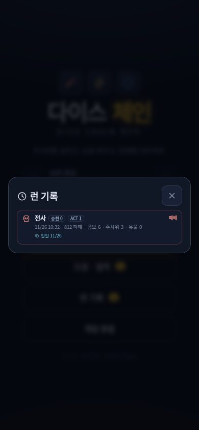

# 🎲 다이스 체인 · Dice Chain RPG

> 주사위를 굴리고, 눈을 바꾸고, 연쇄를 터뜨려라.

주사위 6면을 직접 **단조(forge)**하며 빌드를 만드는 로그라이크 덱빌더.
*Slice & Dice*의 완전 정보 전투, *Dicey Dungeons*의 슬롯 조건, *Balatro*의 연쇄 배율을 한 손에 담았습니다.

**▶ 플레이: https://secretbasesys.github.io/dice-chain-rpg/**

- 모바일(390×844) · 데스크톱(1280×800) 대응, 설치 없이 브라우저에서 실행
- 서버·외부 라이브러리·이미지 파일 없음 (CSS/JS/SVG/WebAudio 자체 생성)
- 진행 상황은 `localStorage`에 저장 — 도감·승천 해금은 런이 끝나도 유지

---

## 스크린샷

| 전투 (모바일 390×844) | 도감 · 업적 | 맵 |
|---|---|---|
|  |  |  |

| 이벤트 선택 | 상점 | 데스크톱 맵 (1280×800) |
|---|---|---|
|  |  |  |

| 타이틀 · 시드 입력 | 첫 판 튜토리얼 | 런 기록 |
|---|---|---|
|  |  |  |

### v3.5 — 시작 선물
- 런을 시작하면 **3개의 시작 선물** 중 하나를 고릅니다: 골드 +35 / 최대 체력 +9 / 무작위 면 +1 / 매 턴 기세 +1 / 무작위 유물 / 여분 주사위. 판마다 조합이 달라 첫 빌드 방향이 매번 다릅니다.

### v3.4 — 업적 진행도 · 안내 다시 보기
- 업적마다 **진행 막대**(최고 콤보·누적 피해·수집 수·승천 해금)를 표시해 다음 목표가 보입니다. 메타에 최고 콤보·최고 피해가 기록됩니다.
- 도움말 하단에 **「첫 판 안내 다시 보기」** 버튼을 추가했습니다.

### v3.3 — 표기·스크린샷 정리
- 잭팟 스킬 설명을 실제 수치(눈 × 1.3)에 맞췄습니다.
- 타이틀·지도·전투·이벤트·상점·덱·도감 스크린샷을 현재 빌드로 갱신했습니다.

### v3.2 — 심연 보스 2종
- 심연(4막 이후)에서 주사위 군주만 반복되던 것을 **심연의 눈**(3턴마다 약화·취약 2)과 **주사위 포식자**(4턴마다 주사위 2개 삼킴)로 교체·교대합니다. 각자 전용 손그림 아트와 등장/반피/사망 대사가 있습니다.

### v3.1 — 주사위 정리(덱 얇게 만들기)
- 상점에 **주사위 정리**(55G)가 추가되었습니다. 원하지 않는 주사위를 버려 덱을 얇게 만들 수 있고, 최소 3개는 남습니다.

### v3.0 — 덱 구성 요약
- 덱 화면에 **면 구성 비율**을 막대로 표시합니다(참격·화염·번개·독·흡혈·증폭·수호…). 어떤 면이 많은 빌드인지 한눈에 보입니다.

### v2.9 — 단조 UI 재설계
- 단조 화면을 **주사위 스트립 → 6면 선택 → 새 면 5개**의 3단 흐름으로 재구성했습니다. 주사위가 5개 이상이어도 스크롤 한 줄로 정리되고, 고른 면에 「교체」 표시가 붙습니다.

### v2.8 — 도감 강화
- 적 도감 카드에 **의도 아이콘 줄**과 **정예·보스 기믹 설명**(분열·부활·봉인·격노·방어·급강하)을 표시해, 만나기 전에 패턴을 익힐 수 있습니다.

### v2.7 — 전투 규칙 버그 수정
- **봉인(주사위 N개 봉인)이 실제로 동작**: 이전에는 곧 버려질 손패를 잠가 아무 효과가 없었습니다. 이제 다음 턴에 배분되는 주사위를 봉인하고, 주사위 군주의 3턴 주기 봉인도 같은 방식으로 적용됩니다(봉인된 주사위는 잠금 아이콘으로 표시).
- **가시 갑옷 중복 발동 제거**: 전사가 방어도를 남긴 턴에 가시 피해가 두 번 들어가던 문제를 고쳤습니다.
- **플레이어 중독·화상 표시**: 적이 건 중독/화상을 체력 옆 상태 칩으로 보여줍니다.

### v2.6 — 오늘의 도전 · 타이틀 압축
- **오늘의 도전** — 날짜에서 뽑은 고정 시드 + 고정 클래스 + 고정 도전 모드 + 승천으로 하루 한 판을 겨루는 카드가 타이틀에 표시됩니다. 그날의 결과(승리/도달 막)가 카드에 남습니다.
- **소형 화면 타이틀** — 360×640에서 로고·카드·버튼이 잘리지 않도록 압축 레이아웃을 적용했습니다.

### v2.5 — 심연 난이도 곡선
- 심연(4막 이후)에서 막마다 **체력 +18% · 공격 +12%**가 추가로 누적됩니다. 봇 실측 도달 깊이가 9(캡)까지 치솟던 것을 5~7 구간으로 조정했습니다.
- 1~3막 난이도는 그대로입니다(추가 배율은 4막부터).

### v2.4 — 이어하기 정합성
- 세이브에 **시드·도전 모드·심연 상태·최대 콤보·깊이**를 함께 저장해, 앱을 닫았다 이어해도 화면과 규칙이 그대로 복원됩니다.
- 3막 보스 직후(심연 선택 화면)에서 나가도 이어하기가 그 화면으로 돌아옵니다.
- 지도에 이동할 노드가 없는 예외 상태에서는 「심연으로 계속 / 여기서 마무리」 안전 버튼을 표시합니다.
- 엔딩 화면에서 보스 대사 배너가 겹치지 않게 정리하고, 통계의 「턴」이 실제 전투 턴 합계로 표시됩니다.

### v2.3 — 심연 모드 (엔드리스)
- 3막 보스를 쓰러뜨리면 **「더 깊이 들어간다 / 여기서 마무리」** 선택이 열립니다. 계속하면 **ACT 4 심연의 나락**부터 끝없이 이어지고, 적 체력·공격이 막마다 누적해서 강해집니다.
- 심연 막 이름(심연의 나락 · 뒤틀린 성좌 · 끝없는 주사위)과 전용 배경색, 최대 10행 맵. 보스는 주사위 군주가 더 강해진 형태로 다시 나옵니다.
- 도달한 최대 깊이는 메타에 저장됩니다. 심연에서 쓰러져도 런 기록에 남습니다.

### v2.2 — 도움말 개편 · 업적 확장
- **게임 방법 4탭** — 기본 / 전투 / 성장 / 기록·모드로 나눠 페어·플라스크·전투 기록·시드·도전·승천까지 한 화면에서 설명합니다.
- **업적 15종** — 완전 연쇄(콤보 8), 맨손의 승리(유물 0), 운명을 초월한 자(승천 10), 오늘의 주사위(일일 시드 승리), 유물 수집가(18종) 추가.

### v2.1 — 소형 화면 대응 · 터치 타깃 정리
- **360×640(초소형) 전투 레이아웃** — 적 카드·슬롯·주사위·조작 버튼을 압축하고 전투 정보 바를 두 줄로 감싸 640px 높이에서도 겹침 없이 한 화면에 들어옵니다.
- **터치 타깃 40px+** — 전투 기록 버튼, 배속 버튼, 상점 재고 변경 버튼을 모두 40px 이상으로 넓혔습니다.
- **상점 하단 바** 고정 스크롤 처리로 작은 화면에서 「떠난다」가 잘리지 않습니다.

### v2.0 — 승천 6~10 · 상점 재고 변경 · 엔딩 정리
- **승천 6~10** — 최종 승천 10까지 확장. 적 체력 +26%, 공격 +30%, 시작 골드 -30, 보스 체력 +35%, 상점가 +30%가 누적됩니다.
- **상점 재고 변경** — 20골드로 진열을 한 번 더 돌립니다(상점당 2회). 상점 헤더의 버튼으로 바로 실행.
- **엔딩 화면 정리** — 시드·도전 모드·승천 태그를 표시하고, 「같은 시드로 다시」로 즉시 재도전할 수 있습니다.

### v1.9 — 도전 모드 · 마이크로 인터랙션
- **도전 모드 4종** — 표준 / **유리 몸**(최대 체력 -30%, 내 피해 +30%) / **탐욕**(상점 +50%, 골드 +50%) / **광란**(적 체력 -15%, 적 공격 +25%). 타이틀에서 고르고, 지도 상단에 표시되며 런 기록에도 남습니다. 도전 모드 승리는 업적 「다른 길」로 이어집니다.
- **마이크로 인터랙션** — 턴마다 주사위가 순차로 굴러 떨어지는 연출, 골드 획득 팝, 보상 카드 스태거 등장, 체력 바 부드러운 감소.

### v1.8 — 콘텐츠 확장
- **적 24종** — 막별 6종으로 확대: 폭발 버섯(독니 공격), 심연 광신도(힘 중첩), 광전사(3연타), 공허의 아귀(흡혈·봉인) 추가.
- **유물 22종** — 선봉의 깃발(첫 턴 +50%), 가시 갑옷(적 턴 종료 시 전체 4 피해), 결투가의 장갑(단일 적 +25%), 수전노의 지갑(골드 +25%) 추가, 전용 아이콘 포함.
- **주사위 20종** — 달 주사위(흡혈·증폭), 톱니 주사위(고방어) 추가.
- **미지 이벤트 16종** — 마른 등대, 주사위 경매 추가(전용 일러스트).

### v1.7 — 시드 · 런 기록 · 페어 시너지
- **커스텀 시드 / 오늘의 시드** — 타이틀에서 시드를 입력하면 맵·주사위·상점·이벤트가 같은 판으로 재현됩니다. 「오늘의 시드」 버튼으로 전 세계(날짜 기준) 동일한 일일 런을 돌 수 있고, 맵 상단 시드 칩을 눌러 복사·공유할 수 있습니다.
- **런 기록** — 타이틀의 「런 기록」에서 최근 30런의 승패·클래스·승천·도달 막·누적 피해·최대 콤보·주사위/유물 수·시드를 확인합니다.
- **첫 판 튜토리얼** — 첫 런 시작 시 세 가지 규칙(조건 배치·콤보 배율·단조)을 한 번만 보여줍니다.
- **페어 시너지** — 같은 눈의 주사위를 연달아 쓰면 그 스킬 피해 +25%. 눈 관리가 곧 화력이 됩니다.
- **정예 고유 기믹** — 오우거는 체력 50%에서 격노(힘 +4), 고대 골렘은 매 턴 방어도 7, 와이번은 3턴마다 급강하(피해 ×1.8).

### v1.6 — 막별 BGM · 전투 연출
- **절차적 WebAudio BGM** — 타이틀/탐험/전투/보스/상점·휴식 5가지 트랙을 코드로 합성해 장면이 바뀔 때 0.9초 크로스페이드로 전환합니다. 음소거 토글과 연동되고, 오디오 파일은 여전히 0개입니다.
- **타격 연출 레이어링** — 콤보가 쌓일수록 타격음 피치가 올라가고, 20 이상 큰 피해에는 치명타 사운드 + 화면 플래시 + 아레나 펀치 연출이 겹칩니다.
- **접이식 전투 기록** — 상단 책 버튼으로 최근 14줄(내 스킬·적 행동·피해/방어/회복)을 열어볼 수 있습니다. 기본은 접힘.
- **상태이상 플로팅 텍스트** — 적·아군 모두에게 적용될 때 해당 위치에 "중독 +2", "취약 +1" 등이 떠오릅니다.

### v1.5 — 네 번째 클래스 · 연금 플라스크
- **독의 연금술사** 추가. 화염·독·번개 면을 쓸 때마다 플라스크에 정수가 담기고, 3개가 차면 조합에 따라 네 가지 비약이 자동 완성됩니다.
- 전투 HUD에 **플라스크 게이지**(정수 색 점 3칸 + n/3)가 상시 표시되고, 정수가 담길 때·비약이 터질 때 플로팅 연출이 나옵니다.
- 전용 주사위 3종(시약·가마솥·엘릭서)과 5개 스킬·각성 5종, 전용 업적 추가. 도감 주사위 18종으로 확장.
- 봇 시뮬레이션으로 4클래스 × 승천 0·3·5 승률을 측정하며 수치를 조정 (아래 밸런스 표).

### v1.4 — 탐험 지도 대개편
- 맵이 **유기적으로 휘는 분기 지도**로 바뀌었습니다. 노드가 좌우로 흔들려 배치되고, 경로는 곡선으로 이어집니다.
- **경로 애니메이션** — 지금 서 있는 노드에서 뻗는 길은 금빛 점선이 흐르고, 지나온 길은 청록으로 남습니다.
- **현재 위치 펄스 · 완료 체크** — 현재 노드는 이중 파문이 퍼지고, 지나온 노드는 체크 배지와 함께 흐려집니다.
- **노드별 손그림 아이콘** — 전투(쌍검)·정예(뿔 해골)·보스(왕관 해골)·단조(모루)·상점(천막)·미지(균열)·휴식(모닥불) 7종을 32×32 SVG로 새로 그림.
- **보스 미리보기 카드** — 다음 보스의 초상·이름·체력이 지도 상단에 상시 표시됩니다.
- **막별 대기 연출** — 잿빛 폐허 / 가라앉은 성소 / 운명의 정점마다 배경 안개·실루엣·떠오르는 불티가 다릅니다.
- **이벤트 14종 · 유물 18종 개별 일러스트** — 이모지 대신 이벤트마다 전용 32×32 SVG(제단·저주받은 검·거울의 방 등)와 유물 전용 아이콘을 사용합니다.

## 게임 방법

1. **굴린다** — 매 턴 가방 속 주사위가 전부 굴려집니다.
2. **배치한다** — 주사위를 **끌어다 놓거나** 탭 → 슬롯을 탭. 슬롯만 탭하면 조건에 맞는 최고 눈이 자동 배치됩니다.
3. **조건을 맞춘다** — 슬롯마다 `아무 눈 / 짝수 / 홀수 / 4 이상 / 소수 / 6` 조건이 있습니다.
4. **조작한다** — 기세(⚡)를 써서 `재굴림 · +1 · -1 · 뒤집기(7-x) · 복제`.
5. **연쇄한다** — 한 턴에 스킬을 이어 쓸수록 배율이 오릅니다 (최대 ×3.5). 3·5·7연쇄에서 화면이 터집니다.
6. **단조한다** — 단조 노드에서 주사위의 **개별 면**을 영구 교체. 이것이 곧 빌드입니다.
7. **같은 눈을 잇는다** — 방금 쓴 주사위와 같은 눈을 연달아 쓰면 **페어 보너스(+25% 피해)**.

### 조작감 · 정보

- **되돌리기(Undo)** — 같은 턴 안에서 배치·재굴림·눈 조작을 되돌립니다 (`Z` 키 또는 ↺ 버튼).
- **완전 정보** — 주사위를 고르면 슬롯마다 예상 피해·방어·처치 여부가 표시되고,
  상단 예고 패널에 **다음 적 턴 총 피해와 치명 경고**가 뜹니다.
- **1x / 2x 배속** 토글, 상태이상·조건·유물·의도는 **탭하면 즉시 툴팁**.
- **전투 기록** — 책 아이콘을 누르면 최근 턴의 스킬·적 행동·피해 내역이 펼쳐집니다.
- PC에서는 `1~9` 주사위 선택, `Enter` 턴 종료, `Z` 되돌리기.

## 클래스

| 클래스 | HP | 기세 | 특징 |
|---|---|---|---|
| 강철의 전사 | 68 | 2 | 방어도를 남기면 다음 턴 3 피해. 맞으면서 때린다 |
| 불꽃의 마도사 | 80 | 3 | 턴마다 기세 +1, 화염·번개 면을 쓰면 2 회복 |
| 운명의 도박사 | 80 | 4 | 콤보 3 이상이면 공격마다 +3 피해 |
| 독의 연금술사 | 74 | 3 | 화염·독·번개 정수를 플라스크에 모아 비약으로 터뜨린다 |

## 시스템

- **단조** — 주사위 면 하나를 5개 후보 중에서 교체. 가격은 막(Act)마다 상승.
- **스킬 각성** — 상점의 「각성의 서」 또는 보상으로 스킬 하나를 영구 강화 (5개 슬롯 전부 각성 가능).
- **플라스크 · 비약 (연금술사)** — 화염·독·번개 면을 쓸 때마다 정수가 담기고, 3개가 차면 조합에 따라 **폭발(전체 피해) / 부식(전체 중독+방어) / 감전(2연쇄+기세) / 균형(회복+취약)** 비약이 자동으로 터집니다. 「촉매」로 원할 때 정수를 소모해 피해·방어로 바꿀 수도 있습니다.
- **미지 이벤트 16종** — 제단·도박·저주·거래·함정. 선택지가 이어지는 2단 이벤트와 확률 분기 포함. 각 이벤트마다 전용 일러스트.
- **보스 고유 기믹** — 슬라임 여왕은 체력 50%에서 분열, 리치는 한 번 되살아나고, 주사위 군주는 3턴마다 주사위를 봉인합니다. 심연에서는 심연의 눈(약화·취약)과 주사위 포식자(주사위 삼킴)가 기다립니다.
- **유물 22종** — 화염 특화, 반격, 콤보, 골드, 저주 계약, 첫 턴 강화, 단일 적 특화 등.
- **도감 · 업적** — 주사위 20 · 유물 22 · 적 26종 수집, 업적 15종.
- **승천(Ascension) 0~10** — 승리할 때마다 단계가 해금됩니다. 적 체력·공격, 시작 골드, 상점 가격이 누적해서 어려워집니다.
- **도전 모드** — 유리 몸·탐욕·광란 세 가지 변칙 규칙으로 같은 게임을 다르게 즐깁니다.

## 밸런스 (봇 시뮬레이션)

`DC.test.sim()` 그리디 봇 기준 60~100런 측정값:

| 승천 | 전사 | 마도사 | 도박사 | 연금술사 |
|---|---|---|---|---|
| 0 (60~100런) | 68% | 65% | 62% | 72% |
| 3 (40~60런) | 47% | 32% | 37% | 40% |
| 5 (40런) | 22% | 15% | 15% | 18% |

같은 조건에서도 판마다 편차가 ±10%p 정도 있어, 위 값은 대략적인 경향으로 보면 됩니다.

승천이 오를수록 적 체력·공격·상점가·보스 체력이 누적되어 승률이 떨어집니다 (사람은 상점·각성·이벤트 선택으로 더 높게 나옵니다).

## 개발

```
src/
  data.js    정적 데이터 — 주사위·면·클래스·스킬·유물·적·보스·이벤트·승천·업적
  art.js     적 24종 + 막별 배경 손그림 SVG
  art2.js    맵 노드 7종 · 유물 22종 · 이벤트 16종 손그림 SVG
  meta.js    도감·승천·업적 영구 저장
  dice.js    주사위 모델 (굴림·면 교체)
  map.js     막별 분기 맵 생성
  combat.js  전투 엔진 (스냅샷 되돌리기·보스 기믹·연쇄 배율)
  audio.js   WebAudio 합성 효과음 + 절차적 BGM 신시사이저
  fx.js      파티클·화면 흔들림·배너
  ui.js      전 화면 렌더 + 드래그·툴팁·애니메이션
  main.js    런 진행·이벤트 효과·상점·저장, 봇 시뮬 레이어
tests/       Playwright 검증 스크립트 (모바일/데스크톱 스크린샷, 레이아웃, 시뮬레이션)
```

단일 파일 빌드: `python3 build.py` → `downloads/dice-chain-rpg.html` (오프라인 실행 가능)

## 검증

- Playwright로 `390×844` · `1280×800` 전 화면 스크린샷 촬영 및 육안 확인
- 콘솔 에러 0, 가로 오버플로 0, 40px 미만 터치 타깃 0 (배속 칩 제외)
- `DC.test.autoRun()` 봇으로 클래스·승천별 승률 시뮬레이션
